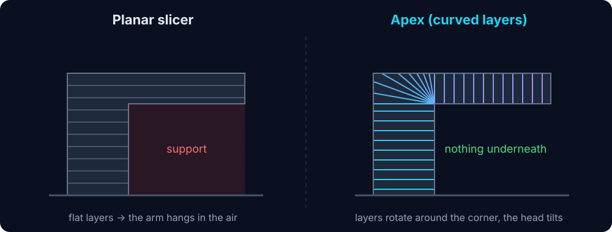
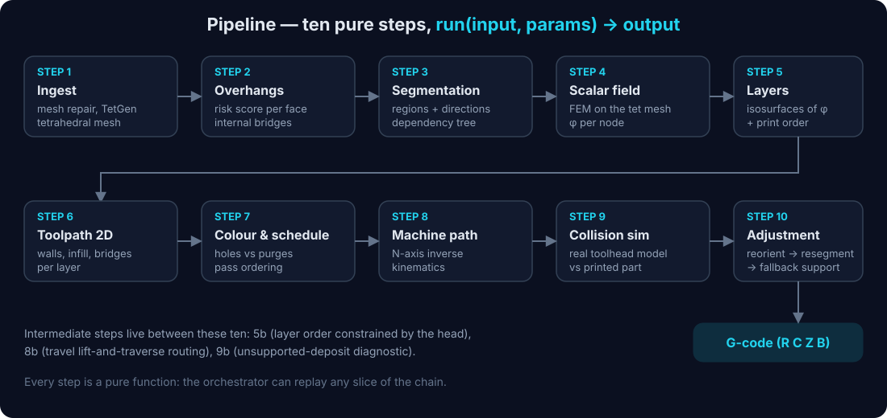
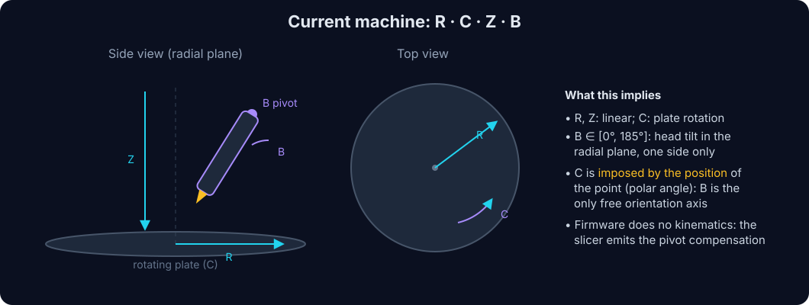
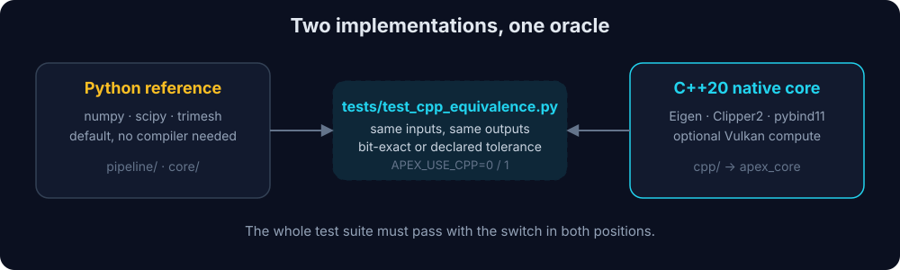

# Apex Algorithm

[English](README.md)

The slicing engine behind **Apex Slicer**: it turns a mesh (STL/3MF) into a collision-checked toolpath for a **4-axis printer** (three linear axes plus one rotary axis), and exports it as G-code. The user interface lives in a separate repository, [apex-ui](https://github.com/aeloxhardware/apex-ui).

> **Pre-release.** Instabilities and crashes may occur. Interfaces and defaults still move.

## Why

A classic slicer stacks flat layers. Whatever hangs in the air needs support, which costs material, time and surface quality. With a rotary axis the nozzle can lean, so layers can follow the part instead of the build plate.



Apex solves for a continuous **scalar field** φ on a tetrahedral mesh of the part. Each layer is an isosurface of φ. The field is shaped so that the print direction stays compatible with every local overhang, so no support is needed.

## Features

**Slicing**

- Curved layers extracted as isosurfaces of a field solved by finite elements on the tetrahedral mesh
- Overhang and **internal bridge** detection (cavity ceilings that a normal test misses)
- Segmentation into sub-volumes, each with its own print direction, ordered as a growth tree from the build plate
- Walls, infill (lines, grid, crossed zig-zag, oscillating spiral) and dedicated bridge handling
- Layer order constrained by the real toolhead, so the head never has to cross matter that is already printed

**Machine**

- Kinematics described as an ordered list of rotation axes, not hard-wired to one machine
- Generic N-axis inverse kinematics, with limits on the speed and acceleration of the tilt axis
- Collision simulation with a **3D model of the real toolhead**, then automatic adjustment (reorient, resegment, fallback support)
- G-code export with pivot compensation and a tip that follows the programmed line

**Colour**

- Colour painted per face, printed by colour group with **temporary holes** filled on a later pass
- Automatic choice between a hole and a classic purge, from a cost model

**Extensibility**

- User constraints (attach points, aesthetic, structural) enter the field through a registry, with no change to the solver
- Every parameter dataclass is serialised to JSON, and a JSON schema is generated for the UI

## Pipeline



Each step is a pure function `run(input, params) -> output` in its own file under [`pipeline/`](pipeline/). There is no hidden state, so the orchestrator ([`main.py`](main.py)) can replay any part of the chain. Shared data contracts are in [`core/mesh_types.py`](core/mesh_types.py).

| Step | File | Output |
|---|---|---|
| 1 | `step1_ingest.py` | cleaned mesh, tetrahedral mesh, spatial indexes |
| 2 | `step2_overhang.py` | risk score per face, internal bridges |
| 3 | `step3_segmentation.py` | regions, directions, dependency graph |
| 4 | `step4_field_solver.py` | scalar field φ |
| 5 / 5b | `step5_layers.py`, `step5b_collision_order.py` | ordered curved layers |
| 6 | `step6_toolpath2d.py` | walls, infill and bridges per layer |
| 7 | `step7_scheduling.py` | colour passes, holes and purges |
| 8 / 8b | `step8_machine_toolpath.py`, `step8b_travel_routing.py` | machine-space path, routed travels |
| 9 | `step9_collision_sim.py` | collision report |
| 10 | `step10_adjustment.py` | adjusted path and adjustment log |

### How the layers are built

The scalar field φ is the **distance to the build plate through the matter**, computed with the heat method (Crane et al.) on the tetrahedral mesh. Layers are its isosurfaces, so every layer is a shell equidistant from the plate and what hangs is printed after what carries it.

The mesh-deformation path (Bird) was removed and the directional-field path (FEM) is no longer the default; its remaining code is to be cleaned up. Bird is kept in the git branch `bird_old`.

## Target machine



The reference machine has a rotating plate (**C**), a radial axis (**R**), a vertical axis (**Z**) and a tilting head (**B**, 0° to 185°). Because there is no Y axis, **C is imposed by the position of the point** and **B is the only free orientation axis**. The engine accounts for this when it picks directions (the field is projected on the reachable half-plane) and when it solves the inverse kinematics.

The firmware does no kinematics: the slicer emits the final axis values, including the compensation for the head pivot. A new machine is described by its `MachineProfile`, not by a firmware update.

## Native core



The engine is being ported to C++20 under [`cpp/`](cpp/), driven by profiling. The Python code stays as the **reference**: [`tests/test_cpp_equivalence.py`](tests/test_cpp_equivalence.py) checks that the native code returns what Python returns, either bit for bit or within a tolerance that is declared and measured. The native module is off by default, and a missing module is never an error.

TetGen is never linked into the native module. It runs in a separate worker process, which also isolates its crashes.

## Getting started

```bash
python -m venv .venv
.venv/bin/pip install trimesh scipy tetgen rtree manifold3d networkx shapely pytest
# optional, repairs self-intersecting meshes
.venv/bin/pip install pymeshfix
```

On Windows use `.venv\Scripts\python.exe`.

Slice a model and write a G-code file:

```bash
python main.py res/test_models/l_shape_overhang.stl --output-gcode out/l_shape.gcode
```

| Option | Meaning |
|---|---|
| `--resolution` | target tetrahedron size in mm (default 1.5) |
| `--layer-height` | target layer height in mm (default 0.2) |
| `--output-gcode` | G-code to write, with a check that the tip never goes below the plate |
| `--output-glb` | inspectable 3D scene (mesh, layers, path) |

### Native build (optional)

```bash
python scripts/build_cpp.py          # CMake + Ninja, finds MSVC on Windows
APEX_USE_CPP=1 python main.py ...    # use the native core
```

### Tests

```bash
pytest                       # Python reference
APEX_USE_CPP=1 pytest        # must pass in both positions
```

## Repository layout

```
main.py         orchestrator and CLI
pipeline/       the pipeline steps
core/           shared types, geometry, spatial indexes, native loader
config/         parameters and JSON schema (bridge to the UI)
file_io/        mesh and toolhead loading, G-code and GLB export
cpp/            C++ core, with third_party/ libraries
scripts/        measurement, export and build tools
res/            test models and the toolhead model
tests/          one test file per step, plus the equivalence oracle
```

## Status

The ten steps run end to end on real models and the test suite passes in both positions of the native switch. Several mechanisms are **opt-in** because they were measured on four reference models and did not improve all of them. The measurements and the reasoning behind each choice are in [`CLAUDE.md`](CLAUDE.md) and [`DT.md`](DT.md).

Still open: a real `resegmentation_hook` for step 10, a true 3D path planner for travel moves, and a machine-ready validation on the physical printer.

## Credits & Citations

Apex Algorithm builds on the work below. Licences were read from the files vendored in this repository.

**Algorithm and research**

- **Thank you to [Joshua Bird](https://github.com/jyjblrd) and his [S4 Slicer](https://github.com/jyjblrd/S4_Slicer)** (GPL-3.0), whose work inspired this project. The Bird path has been removed from this branch but is kept in the git branch `bird_old`, with its notices. Please cite it (see `CITATION.cff`):

  ```bibtex
  @software{bird_s4_slicer,
    author  = {Bird, Joshua},
    title   = {S4 Slicer -- Generic Non-Planar Slicer},
    license = {GPL-3.0},
    url     = {https://github.com/jyjblrd/S4_Slicer}
  }
  ```

- Heat method for geodesic distance: Crane, Weischedel and Wardetzky, *Geodesics in Heat* (the field of step 4)
- Minimum-weight polygon triangulation: Klincsek, used to refill holes in step 1
- Triangle-triangle intersection: Möller's method, in the self-intersection resolver
- Classic building blocks: Dijkstra shortest paths, marching tetrahedra, the Viterbi algorithm, the Householder QR and the Hann window

**Native libraries (vendored in `cpp/third_party/`)**

| Library | Version | Licence | Use |
|---|---|---|---|
| [Eigen](https://eigen.tuxfamily.org) | 3.4.0 | MPL-2.0 | linear algebra, least squares |
| [Clipper2](https://github.com/AngusJohnson/Clipper2) | 2.0.1 | BSL-1.0 | polygon offsets for walls and infill |
| [volk](https://github.com/zeux/volk) | vulkan-sdk-1.4.363.0 | MIT | Vulkan loader |
| [VulkanMemoryAllocator](https://github.com/GPUOpen-LibrariesAndSDKs/VulkanMemoryAllocator) | 3.3.0 | MIT | GPU memory |
| [pybind11](https://github.com/pybind/pybind11) | build dependency | BSD-3-Clause | Python bindings |

**Python dependencies**

| Package | Licence | Use |
|---|---|---|
| [TetGen](https://wias-berlin.de/software/tetgen/) via the `tetgen` wrapper | AGPL-3.0 | tetrahedral meshing, run in a separate process |
| [pymeshfix](https://github.com/pyvista/pymeshfix) | AGPL-3.0 | optional mesh repair |
| [trimesh](https://github.com/mikedh/trimesh) | MIT | mesh handling, GLB export |
| [NumPy](https://numpy.org), [SciPy](https://scipy.org) | BSD-3-Clause | numerics, sparse solvers |
| [Shapely](https://github.com/shapely/shapely) | BSD-3-Clause | 2D offsets and clipping |
| [NetworkX](https://networkx.org) | BSD-3-Clause | graphs |
| [Rtree](https://github.com/Toblerity/rtree) | MIT | spatial index |
| [manifold3d](https://github.com/elalish/manifold) | Apache-2.0 | boolean operations |
| [pytest](https://pytest.org) | MIT | tests |

**Assets**

- Toolhead model `res/3d/toolheads/aetheris-4`: based on the BIQU H2 V2S Lite hot end
- Test models in `res/test_models/`: the Benchy-derived and other community models still need their authors and licences listed (see the TODO below)

**Companion project**

- [apex-ui](https://github.com/aeloxhardware/apex-ui), the user interface, based on Romain Pras's work

## License

[GNU GPL 3.0](LICENSE)

---

<sub>TODO for this README: add a French version, add screenshots of real slices and toolpaths, confirm the authors and licences of the test models, and decide how the AGPL components are described once the licence plan is final.</sub>
